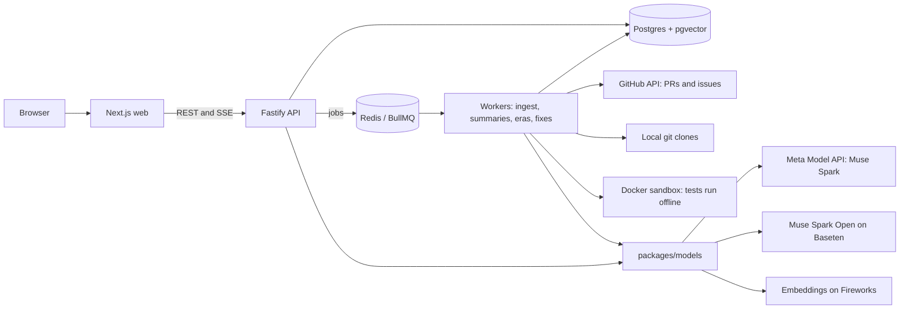

# Archaeo

Point Archaeo at any GitHub repo to **understand its past, see its present, and fix its future**.

Built for the Meta Global AI Developer Hackathon (Oct 26 – Nov 4, 2026).

## The problem

Joining an unfamiliar codebase is slow. The reasons behind the code are buried in thousands of commits and pull requests nobody reads, the architecture lives in people's heads, and a bug report arrives as a symptom with no pointer to the code. Archaeo reads the whole repository, history included, and answers with citations you can check: every claim links to a commit, a pull request or a `path:line` range.

## What it does

- **The Past.** A timeline of the project's eras, each with a narrative that cites its key commits and pull requests. "Why does this exist?" for any file or symbol finds the commit and pull request that introduced it and explains how it evolved.
- **The Present.** An interactive architecture map (size is lines of code, color is churn, hotspots stand out, folders expand). A Q&A agent with six code tools and hard limits on tool calls, time and cost streams answers whose `path:line` citations open in a code viewer. A request-flow walkthrough follows the call graph from an entry point and highlights each hop on the map.
- **The Future.** Paste an error, a stack trace or a GitHub issue URL to get a case file: ranked suspects, evidence and a root-cause hypothesis. Archaeo then writes patches and runs each one against the full test suite in an offline Docker sandbox, up to 3 attempts. A patch is offered only if it introduces no new test failures, and its regression tests are checked to fail without the fix. Nothing is pushed until you approve, and approval opens a pull request inside your fork.

Every commit, pull request and code citation is checked against the repository before it is shown.

## How it works



1. **Ingest.** Clone the repo, parse it with tree-sitter (Python, TypeScript, JavaScript), build import and call graphs, read the commit history plus merged pull requests and issues, embed code and history into pgvector, and summarize files, folders and the repo.
2. **Answer.** Agents work with six tools over that index (code search, file reading, callers, callees, git blame, directory listing) under per-run limits. Answers must cite what they used, and citations that don't resolve are dropped.
3. **Fix.** The bug tracer ranks suspects from stack frames, the call graph and code search. The fixer checks the repo out at the traced commit in a fresh worktree and runs the test suite in a container with no network, capped memory, CPU and processes.

## Models

All model calls go through `packages/models`, which routes each job to a model set in `.env`.

| Job | Function | Model | Setting |
|---|---|---|---|
| File and commit summaries | `summarizeCheap` | Muse Spark Open, Meta's open-weights model, on Baseten (`meta-models/muse-spark-open`) | `MODEL_SUMMARIZE` |
| Era stories, Q&A, bug reasoning | `reason` | Muse Spark on the Meta Model API (`muse-spark-1.3`) | `MODEL_REASON` |
| Patches and tests | `writeCode` | Muse Spark (`muse-spark-1.3`), the model Meta's Muse Code agent is built on | `MODEL_WRITE_CODE` |
| Retrieval | `embed` | Qwen3 Embedding 0.6B on Fireworks (`accounts/fireworks/models/qwen3-embedding-0p6b`); the Meta Model API has no embedding model | `MODEL_EMBED` |

With `MODEL_PROVIDER=mock` (the default), everything runs offline with canned model outputs. To use the real models:

1. In `.env`, set `MODEL_PROVIDER=live` and three keys: `META_API_KEY` (Meta Model API), `BASETEN_API_KEY` and `FIREWORKS_API_KEY`. The model IDs above are the defaults. Meta's prices are built in; add the Baseten and Fireworks prices to `MODEL_PRICING` so their calls are costed too.
2. Run `pnpm models:check`. It sends one small request per model and confirms tool calling, JSON answers, diffs, summaries, and that embeddings fit the database (1,024 dimensions).
3. Re-ingest each repo, or run `pnpm demo:prepare`. Archaeo records which models produced a repo's embeddings, summaries and timeline, and redoes them when the models change.

## Quick start

Requires Node 22+, pnpm 9, and Docker (also used to sandbox test runs for the fixer).

```bash
cp .env.example .env
docker compose up -d
pnpm install
pnpm db:deploy
pnpm dev
```

- Web: http://localhost:3000
- API: http://localhost:4000 (`GET /health`, `POST /repos`, `GET /repos/:id`, `GET /repos/:id/progress`, `POST /repos/:id/ingest`, `GET|POST /repos/:id/eras`, `POST /repos/:id/why`, `GET /repos/:id/files`, `GET /repos/:id/symbols`, `GET /repos/:id/map`, `GET /repos/:id/file`, `GET /repos/:id/symbols/search`, `POST /repos/:id/flow`, `POST /repos/:id/ask` and `POST /repos/:id/trace` as SSE, `GET /repos/:id/cases`, `GET /repos/:id/runs/:runId`, `POST /repos/:id/runs/:runId/fix`, `POST /repos/:id/fix-attempts/:attemptId/approve`, `GET /config`)

Set `GITHUB_TOKEN` in `.env`: without it, GitHub allows 60 API requests per hour, which is about one first-time ingest of a mid-sized repo.

## Deploy

`docker-compose.prod.yml` runs everything on one Linux server with Docker: Postgres, Redis, the API, the workers, the web app, and Caddy in front (automatic HTTPS for a domain, with the API under `/api` on the same origin).

```bash
git clone https://github.com/tausif2907/archaeo.git
cd archaeo
cp .env.production.example .env.production
```

Fill in `.env.production`: the domain (`SITE_ADDRESS`, `WEB_ORIGIN`), a Postgres password, the model keys and a GitHub token. Then start the stack and get the demo repos ready:

```bash
docker compose -f docker-compose.prod.yml --env-file .env.production up -d --build
```

```bash
docker compose -f docker-compose.prod.yml --env-file .env.production exec worker pnpm demo:prepare
```

`pnpm demo:prepare` ingests the repos listed in `demo/demo.json`, waits for their timelines, then runs each demo question once so it is answered from the cache during the demo. Results stay cached across restarts.

`PUBLIC_DEMO=true` makes the link safe to share: visitors explore the pre-ingested repos, while adding or re-ingesting repos, regenerating timelines and publishing pull requests are turned off. Fix runs still work and stay in the sandbox.

The worker runs fix sandboxes through the server's Docker, so it has access to the Docker socket. Use a server dedicated to Archaeo.

## Scripts

| Command | What it does |
|---|---|
| `pnpm dev` | Runs web, api, and worker in watch mode |
| `pnpm typecheck` | `tsc --noEmit` in every package |
| `pnpm lint` | ESLint over the workspace |
| `pnpm test` | Vitest in every package |
| `pnpm db:migrate` | Creates and applies a Prisma migration (dev) |
| `pnpm eval` | Runs the history, Q&A and bug evals for every repo in `packages/evals/datasets/` and writes `evals/REPORT.md` (`-- --repo click`, `-- --suite qa`, `-- --no-fix` narrow a run; the repos must be ingested) |
| `pnpm eval:history`, `pnpm eval:qa` | One suite, printed to the console (`-- --repo got` for another repo) |
| `pnpm eval:bugs` | Traces and fixes the historical bugs in the sandbox; `-- --replay` replays the real fix to check the pipeline and approval gate |
| `pnpm demo:prepare` | Ingests the repos in `demo/demo.json` (again if they were built with other models) and warms the demo answers |
| `pnpm models:check` | One small request per configured model: keys, model IDs, tool calling, diffs and embedding size |
| `pnpm e2e` | Playwright end-to-end tests: map speed and expand/collapse, Q&A citations, flow trace (needs the stack running; first run `pnpm exec playwright install chromium`) |
| `pnpm check:citations` | Fails if any stored era narrative cites a commit or PR that doesn't exist |

## Layout

```
apps/web          Next.js UI
apps/api          Fastify API
apps/worker       BullMQ workers
packages/db       Prisma schema and client
packages/models   All model calls: summarizeCheap, reason, writeCode, generateImage, embed
packages/shared   zod schemas and shared types
packages/ingest   clone, tree-sitter parsing, import/call graph, git log, GitHub fetchers, chunking
packages/agent    Agent loop, code tools, run limits, Q&A, flow tracing, history reasoning, bug tracing and the fixer
packages/evals    Eval datasets (per repo) and the eval runner
packages/sandbox  Docker sandbox: worktree per run, lock-pinned test deps, offline test runs, diff and pytest helpers
demo/             Demo repos and warm-up questions for pnpm demo:prepare
deploy/           Caddy config for docker-compose.prod.yml
```
